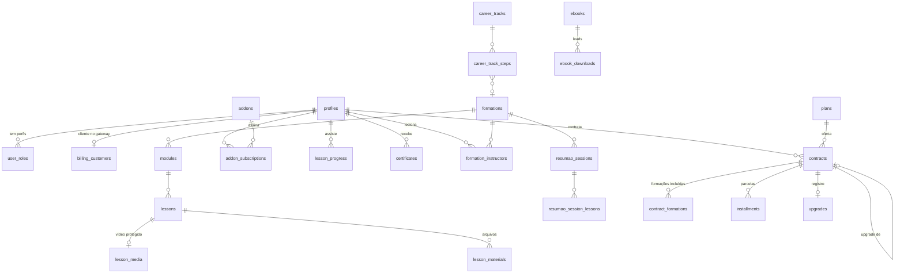
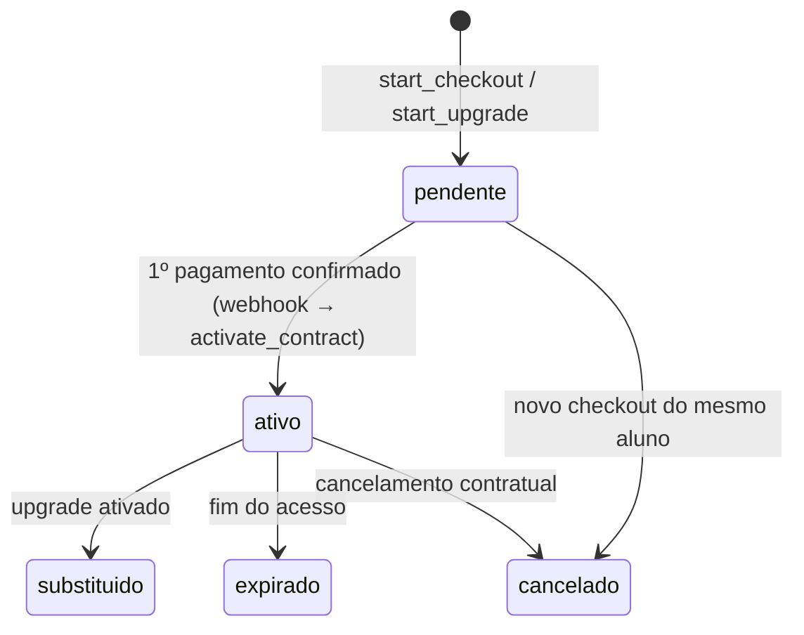

# Modelo de dados

Postgres no Supabase. Valores em centavos (`integer`) e datas com fuso (`timestamptz`). Migrations em `supabase/migrations`, dados iniciais em `supabase/seed.sql`.

## Diagrama

## Grupos de tabelas

| Grupo | Tabelas | Para quê |
|---|---|---|
| Pessoas | `profiles`, `user_roles`, `billing_customers` | Conta, perfis de acesso e vínculo com o cliente no Asaas (CPF isolado) |
| Catálogo | `formations`, `modules`, `lessons`, `lesson_media`, `lesson_materials`, `formation_instructors` | Formações, ementa, liberação semanal (`release_at`), vídeo e materiais |
| Ofertas | `plans`, `addons`, view `plan_availability` | Lotes e planos (preço, vagas, janela de venda, acesso, `rank` para upgrade) e complementos mensais |
| Financeiro | `contracts`, `contract_formations`, `installments`, `upgrades`, `addon_subscriptions` | Matrícula pelo preço total, parcelas, crédito e cancelamento no upgrade |
| Aprendizagem | `lesson_progress`, `certificates`, `resumao_sessions`, `resumao_session_lessons` | Progresso, certificados e gravações do Resumão |
| Site | `career_tracks`, `career_track_steps`, `vlog_posts`, `ebooks`, `ebook_downloads`, `site_pages`, `site_settings`, `contact_messages` | Itens do rodapé: Trilhas, Vlog, E-books, institucionais, WhatsApp e Fale Conosco |
| Aula e comunidade | `lesson_comments`, `forum_topics`, `forum_posts`, `material_downloads`, `profile_documents` | Comentários com respostas, fórum com moderação, rastreio de downloads e CPF da marca d'água |
| Operação | `gateway_events`, `audit_log` | Idempotência do webhook e trilha de auditoria |

## Ciclo de vida do contrato

## Regras de negócio no banco

| Regra (PDF) | Onde |
|---|---|
| Lotes de janeiro com 200, 100 e 50 vagas, vendidos em sequência | `plans.seats`, `seats_taken`, `start_checkout` (trava com `for update`) |
| Vaga reservada enquanto o Pix ou boleto não é pago | `contracts.hold_until` (3 dias) |
| Preço total, parcelamento é só forma de pagamento | `contracts.list_price_cents` e `installments` |
| Acesso de 12, 24, 36 meses ou vitalício condicionado | `plans.access_months`; `access_ends_at` nulo = vitalício |
| Upgrade: novo preço menos o total já pago | `upgrade_quote` (crédito inclui o que veio de upgrade anterior) |
| Acesso reiniciado na confirmação do upgrade | `activate_contract` |
| Parcelas pendentes sem cobrança duplicada | `activate_contract` marca como canceladas; o servidor cancela no Asaas |
| Novas formações só no Legado | `plans.includes_future_formations` + `formations.launched_at` em `user_has_formation` |
| Inglês e combo só no 2º ano | `addons.available_from` |
| Aulas novas toda semana | `lessons.release_at`, checado em `can_view_lesson` |
